# Lab Reset

Lab Reset is a small Windows app for resetting the lab VMs at the end of a class. It works on the teacher PC and on the other lab PCs over the network. It does two things:

- **Extract** fresh copies of the lab VM archives (for example `Forti.7z` or `PaloAltoVM.7z`).
- **Delete** the VMs that students extracted.

Every PC keeps its VMs in a folder called **`__RivanVMs`**. That folder can be on any drive (`C:\__RivanVMs`, `D:\__RivanVMs`, and so on), and the app finds it on each PC by itself. The app **only ever extracts and deletes inside `__RivanVMs`**. It never deletes the archives themselves.

> The screenshots use example data: a teacher PC called `LAB-TEACHER` and lab PCs `10.3.3.101` to `10.3.3.110`.

---

## Contents

- [Part 1: Install Lab Reset (teacher PC)](#part-1-install-lab-reset-teacher-pc)
- [Part 2: Prepare the lab PCs (once)](#part-2-prepare-the-lab-pcs-once)
- [Part 3: How to use Lab Reset, step by step](#part-3-how-to-use-lab-reset-step-by-step)
- [What the tile colours mean](#what-the-tile-colours-mean)
- [Troubleshooting](#troubleshooting)
- [Safety rules (built in)](#safety-rules-built-in)
- [What's in the folder](#whats-in-the-folder)
- [How "each PC extracts its own copy" works](#how-each-pc-extracts-its-own-copy-works)

---

## Part 1: Install Lab Reset (teacher PC)

You only need to do this once, on the PC you will run Lab Reset from. The lab PCs do **not** need anything installed, because Lab Reset copies its small helper to them automatically.

**What you need:** Windows 10 or 11 with .NET Framework 4.8. It's already built into Windows 10 and 11, so there's nothing to download.

### Step 1: Get the files

Choose **one** of these:

- **Option A: Download the ZIP (no Git needed)**
  1. Open https://github.com/HayzeuMagic/labreset
  2. Click the green **`<> Code`** button, then **Download ZIP**.
  3. Right-click the downloaded ZIP and choose **Extract All...**. Extract it to **`C:\`**.
  4. Rename the extracted folder from `labreset-main` to **`LabReset`**, so you end up with `C:\LabReset`.

- **Option B: Clone with Git**
  ```
  git clone https://github.com/HayzeuMagic/labreset.git C:\LabReset
  ```

### Step 2: Build `LabReset.exe`

1. Open `C:\LabReset` in File Explorer.
2. Double-click **`build.bat`**.
3. A black window opens. When it says **`Built LabReset.exe and LabResetAgent.exe successfully.`**, press any key to close it.

You now have two new files in `C:\LabReset`:

| File | What it is |
|---|---|
| **`LabReset.exe`** | The app you run. |
| **`LabResetAgent.exe`** | The helper that Lab Reset sends to each lab PC. Keep it next to `LabReset.exe`. |

> `build.bat` uses the C# compiler that comes with Windows, so you don't need Visual Studio. If it says *"Could not find the C# compiler"*, install .NET Framework 4.8 from Microsoft and run it again.

### Step 3: Run it

1. Double-click **`LabReset.exe`**.
2. Windows asks *"Do you want to allow this app to make changes?"*. Click **Yes**. The app needs administrator rights to delete and extract VMs.
3. *(Optional)* Right-click `LabReset.exe` and choose **Send to > Desktop (create shortcut)** to add a shortcut to your desktop.

> If Windows SmartScreen shows *"Windows protected your PC"*, click **More info**, then **Run anyway**. This happens because you built the app yourself, so it isn't signed.

### Step 4 (optional): Put the lab archives into the app

Lab Reset automatically lists the archives in **this PC's own `__RivanVMs` folder**, so usually there's nothing to do here.

If you want archives to be permanently "built in" to the app, run `add-builtin.bat` and give it the folder that contains the archives:

```
add-builtin.bat "D:\__RivanVMs"
```

This copies the archives into `C:\LabReset\Library` and marks them as built-in (in `Library\builtin.txt`), so they can't be removed from inside the app.

---

## Part 2: Prepare the lab PCs (once)

Lab Reset reaches the other PCs over the network through their hidden admin shares (`\\10.3.3.162\D$`), the same way File Explorer does. Do the following **once on every lab PC**:

1. **Make a `__RivanVMs` folder** on one of the drives (for example `D:\__RivanVMs`), and put the lab archives in it (`Forti.7z`, `PaloAltoVM.7z`, ...). Each PC extracts from **its own** copy, so nothing big is sent over the network.
2. **Allow File and Printer Sharing** in Windows Firewall:
   *Control Panel > Windows Defender Firewall > Allow an app through Windows Firewall > tick **File and Printer Sharing** (Private).*
3. **Use an admin account.** The Windows account you run Lab Reset with must be an **administrator on the lab PC**. If it isn't, create the **same local admin account with the same password** on every lab PC (for example `LabAdmin`). You will enter it in Lab Reset with **Network login...** (see [Step 6](#step-6-only-if-needed-enter-a-network-login)).
4. **If you use local accounts**, run this once on each lab PC in an **administrator** Command Prompt:
   ```
   reg add HKLM\SOFTWARE\Microsoft\Windows\CurrentVersion\Policies\System /v LocalAccountTokenFilterPolicy /t REG_DWORD /d 1 /f
   ```
5. *(Only if antivirus blocks the helper)* Add `C:\ProgramData\LabReset` as an antivirus exclusion on the lab PCs.

---

## Part 3: How to use Lab Reset, step by step

### Step 1: Know the screen

When Lab Reset opens, the window has five parts. You work through them in order, **1 → 2 → 3**, and watch **4** and **5**.

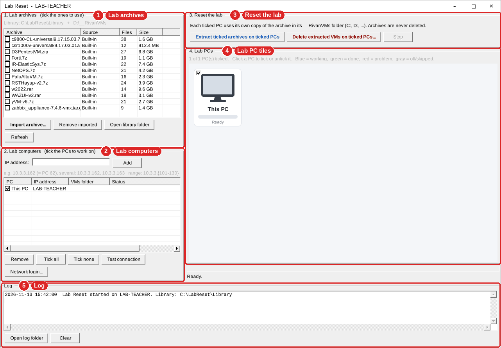

| # | Section | What it's for |
|---|---|---|
| **1** | **Lab archives** | The VM archives you can extract. Tick the ones you want. |
| **2** | **Lab computers** | The PCs to work on. Add them by IP address and tick them. |
| **3** | **Reset the lab** | The **Extract** and **Delete** buttons, and **Stop**. |
| **4** | **Lab PCs** | One tile per PC, each with its own progress bar. |
| **5** | **Log** | Everything that happened, line by line. |

---

### Step 2: Tick the archives you want to extract or delete

In **section 1 (Lab archives)**, tick the box next to each archive you want. In this example, **Forti.7z** and **PaloAltoVM.7z** are ticked.

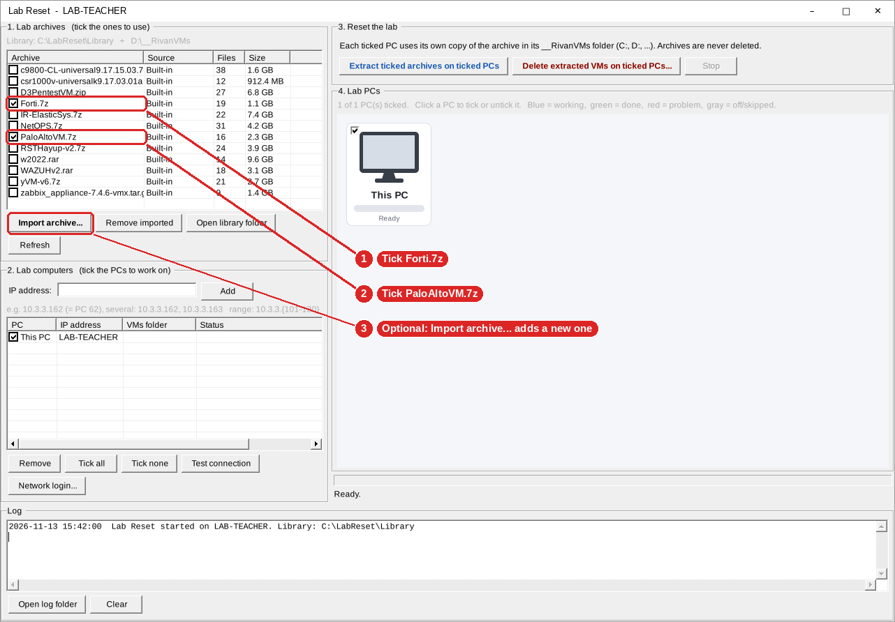

1. Tick **`Forti.7z`**.
2. Tick **`PaloAltoVM.7z`**.
3. *(Optional)* To add a new archive that isn't in the list, click **Import archive...** and choose a `.zip`, `.7z`, `.rar`, `.tar` or `.tar.gz` file. You can also drag files onto the list. Imported archives are copied into `Library\` and stay in the app.

Other buttons in this section:

| Button | What it does |
|---|---|
| **Remove imported** | Removes an archive *you* imported. Built-in archives and archives in `__RivanVMs` can't be removed. |
| **Open library folder** | Opens `C:\LabReset\Library` in File Explorer. |
| **Refresh** | Re-reads the archive list. |

---

### Step 3: Add the lab PCs by IP address

In **section 2 (Lab computers)**, type the lab PCs' IP addresses into the **IP address** box, then click **Add**.

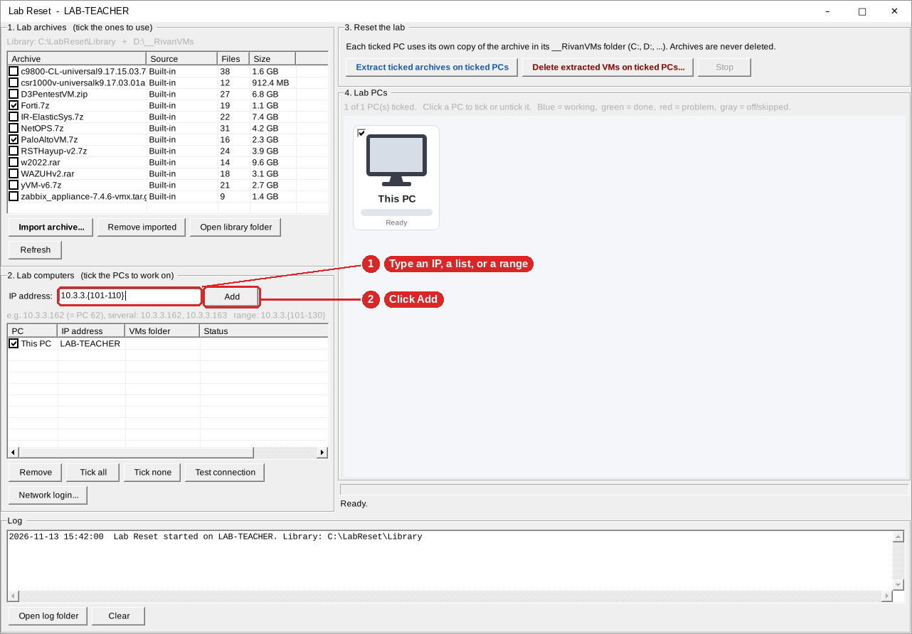

1. Type the IP address(es) in the **IP address** box. You can type:
   - **one PC:** `10.3.3.162`
   - **several PCs**, separated by commas: `10.3.3.162, 10.3.3.163`
   - **a range** in curly brackets: `10.3.3.{101-110}` adds `10.3.3.101` to `10.3.3.110`
2. Click **Add** (or press **Enter**).

The **PC number is the last 2 digits of the IP**, so `10.3.3.162` shows up as **PC 62**. *This PC* (the teacher PC) is always in the list.

You only have to add the PCs once. The list is saved and comes back the next time you open Lab Reset.

---

### Step 4: Tick the PCs you want to work on

Every new PC is ticked. **Untick** any PC you want to leave alone.

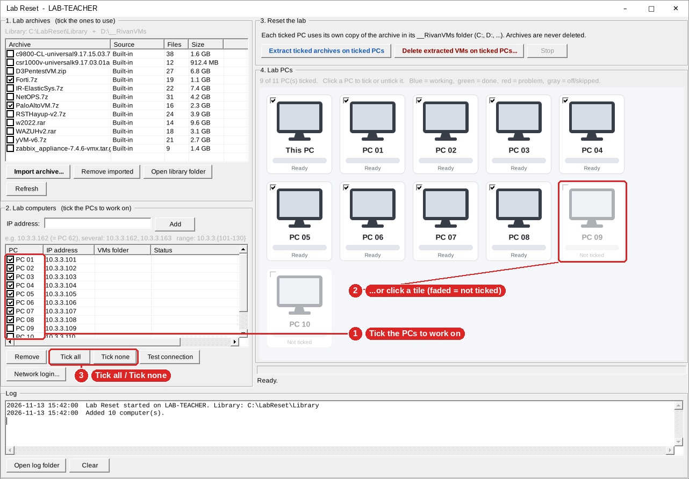

1. Tick or untick PCs in the list.
2. **Or click a PC's tile** in section 4 to tick or untick it. Unticked PCs look **faded** (PC 09 and PC 10 here).
3. Use **Tick all** / **Tick none** to tick or untick every PC at once.

To take a PC out of the list for good, click it to select it and click **Remove**. *This PC* can't be removed; untick it instead.

---

### Step 5: Click "Test connection"

Before extracting, check that Lab Reset can reach every ticked PC.

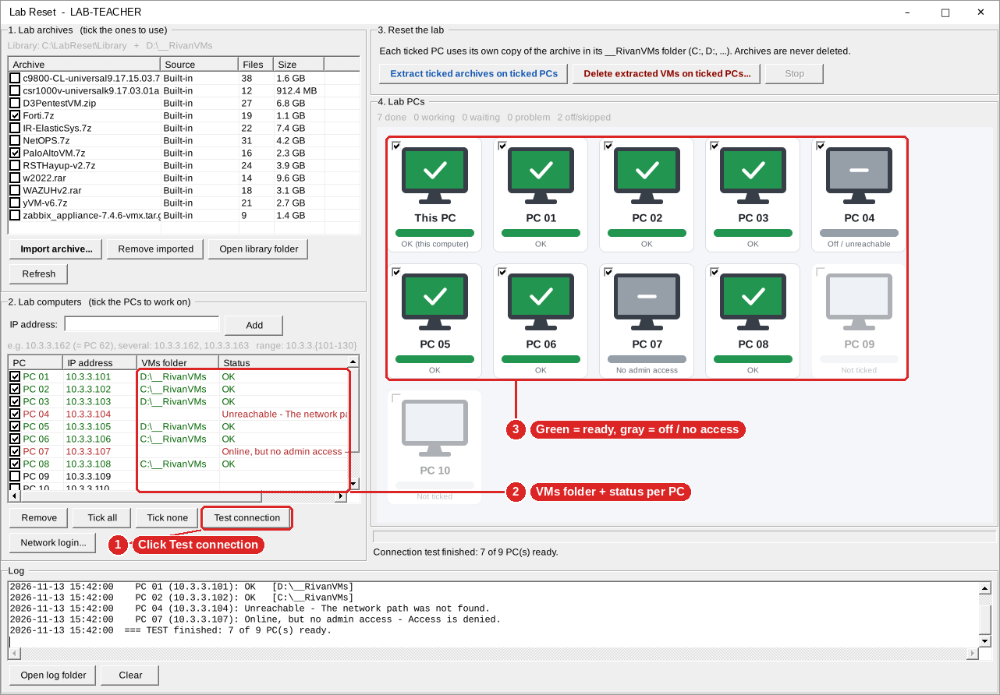

1. Click **Test connection**.
2. Read the **VMs folder** and **Status** columns. They show where each PC's VMs folder is (for example `D:\__RivanVMs`) and whether the PC is ready.
3. Check the tiles: **green ✓ = ready**, **gray – = can't be used**.

| Status | What it means | What to do |
|---|---|---|
| **OK** | Ready. | Nothing. |
| **Unreachable** | The PC is off, or the firewall is blocking it. | Turn it on and check [Part 2](#part-2-prepare-the-lab-pcs-once), step 2. |
| **Online, but no admin access / Access is denied** | Your account isn't an admin on that PC. | Do [Step 6](#step-6-only-if-needed-enter-a-network-login). |
| **No __RivanVMs folder on any drive** | The VMs folder is missing on that PC. | Create it ([Part 2](#part-2-prepare-the-lab-pcs-once), step 1). |

---

### Step 6 (only if needed): Enter a network login

Only do this if **Test connection** said **Access is denied** for some PCs.

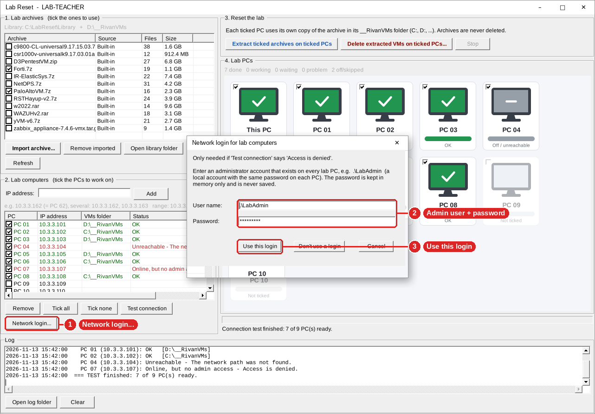

1. Click **Network login...**.
2. Type the admin account that exists on every lab PC, for example **`.\LabAdmin`**, and its **password**.
3. Click **Use this login**.

Then click **Test connection** again. The password is kept in memory only and is **never saved**, so you need to enter it again each time you open Lab Reset. **Don't use a login** switches back to your own Windows account.

---

### Step 7: Click "Extract ticked archives on ticked PCs"

**Close VMware on the lab PCs first.**

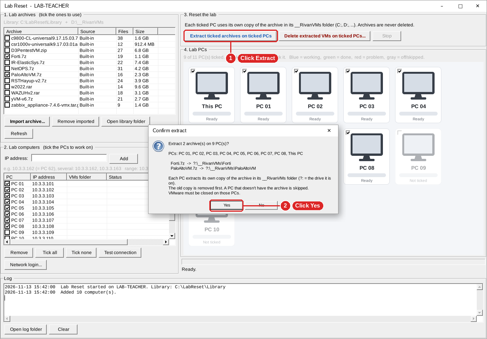

1. In **section 3 (Reset the lab)**, click **Extract ticked archives on ticked PCs**.
2. A **Confirm extract** window lists the PCs and where each archive will go (for example `?:\__RivanVMs\Forti`, where `?:` is the drive the folder is on). Click **Yes**.

What happens:
- **Every ticked PC extracts its OWN copy** of each ticked archive from its own `__RivanVMs` folder, right into that folder. Nothing big is sent over the network.
- The **old copy is removed first**, so students get a clean VM.
- All PCs work **at the same time**.
- A PC that doesn't have the archive shows **Archive missing** and is skipped.

---

### Step 8: Watch the progress

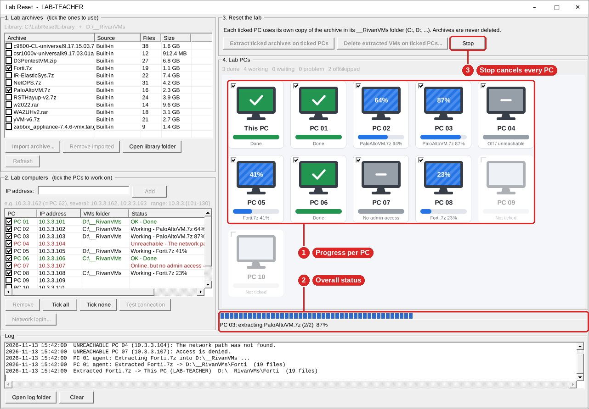

1. **Each PC tile has its own progress bar.** Blue tiles with moving stripes are working; the % shows how far along they are.
2. The **status bar** under the tiles shows the overall progress.
3. Click **Stop** to cancel the job on **every** PC.

The other buttons are greyed out while a job is running.

---

### Step 9: Check the results

When it's finished, every ticked PC's tile shows the result.

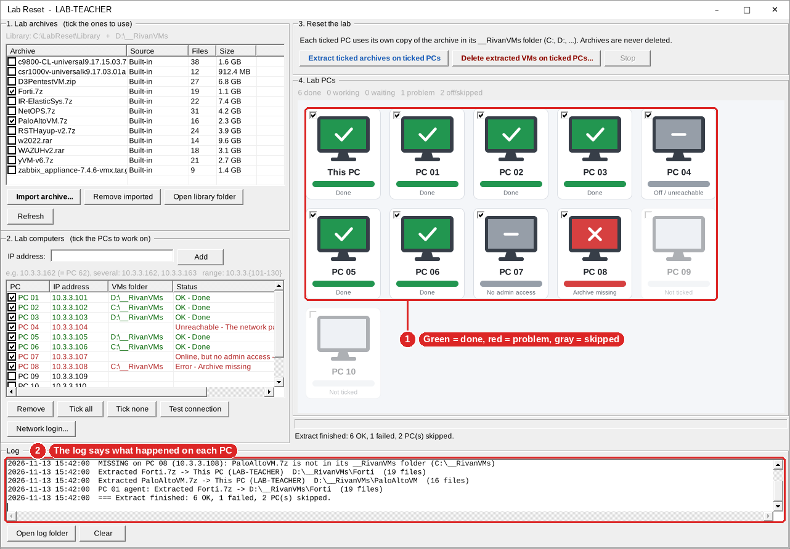

1. **Green ✓ = done**, **red ✗ = problem**, **gray – = skipped** (off or no access). In this example, PC 08 is red because it doesn't have `PaloAltoVM.7z` in its `__RivanVMs` folder.
2. The **log** says exactly what happened on each PC. Click **Open log folder** to see the saved log files (one per day, in `C:\LabReset\Logs`).

Fix any red or gray PCs (see [Troubleshooting](#troubleshooting)), tick just those PCs, and click **Extract** again.

---

### Step 10: Delete the students' VMs (end of class)

Use this to clean up the VMs that were extracted. **The archives are kept.**

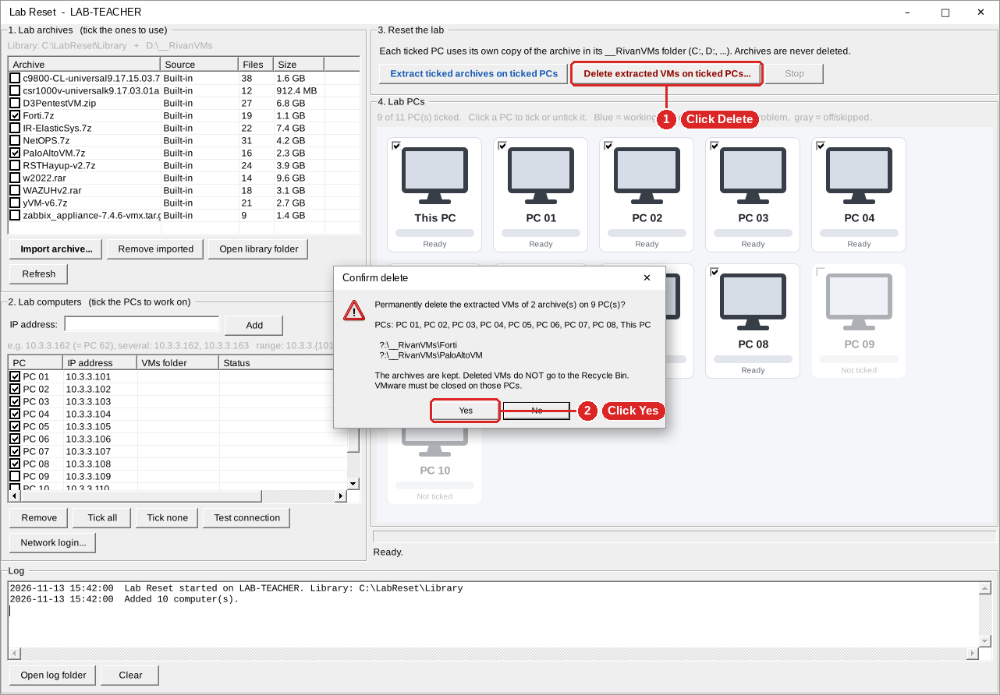

1. Tick the archives whose VMs you want to delete (section 1) and the PCs (section 2), then click **Delete extracted VMs on ticked PCs...**.
2. A **Confirm delete** window lists exactly what will be deleted (for example `?:\__RivanVMs\Forti`). Check it, then click **Yes**.

If **no archive is ticked**, Lab Reset offers to delete the VMs of **all** archives in the list.

> ⚠️ Deleted VMs do **not** go to the Recycle Bin. Close VMware on the lab PCs first.

When it's finished, the tiles turn green and the status says how many items were deleted:

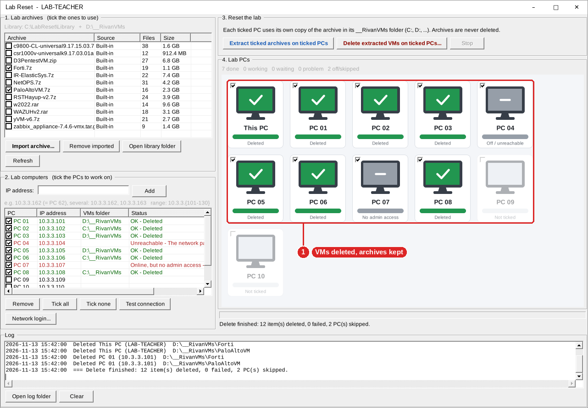

---

## What the tile colours mean

| Tile | Meaning |
|---|---|
| **Light gray, "Ready"** | Ticked, nothing running yet. |
| **Blue, moving stripes** | Working (with % done). |
| **Green ✓** | Done. |
| **Red ✗** | Problem. Check the log. |
| **Gray –** | Off, unreachable, no admin access, or no `__RivanVMs` folder. |
| **Faded** | Not ticked. Click the tile to tick it. |

---

## Troubleshooting

| Problem | Fix |
|---|---|
| **"File is in use"** when deleting or extracting | A VM is still running on that PC. Close VMware and try again. |
| **Unreachable** | The PC is off, or *File and Printer Sharing* is blocked in its firewall. |
| **Access is denied** | Use **Network login...** with an admin account that exists on that PC. If it's a local account, run the `reg add` command from [Part 2](#part-2-prepare-the-lab-pcs-once). |
| **Archive missing** | Copy the archive into that PC's `__RivanVMs` folder. |
| **Not enough space** | Extracted VMs are often 2 to 3 times the archive size. Free up space on that drive. |
| **Helper blocked by antivirus** | Exclude `C:\ProgramData\LabReset` on the lab PCs. |
| **The first start is slow** | Lab Reset reads each archive's file list the first time and saves it in `Library\.cache`. Later starts are instant. |
| **"WARNING: not running as administrator"** in the log | Close the app, right-click `LabReset.exe`, and choose **Run as administrator**. |

---

## Safety rules (built in)

- Only things **inside** a `__RivanVMs` folder can be deleted. The `__RivanVMs` folder itself, and everything outside it, can't be.
- Archive files (`.zip`, `.7z`, `.rar`, `.tar`, `.tar.gz`) are never deleted.
- The app's own folder is never touched. Windows, Program Files and other system folders are never searched.
- These rules are checked again right before every delete.

---

## What's in the folder

| File | What it is |
|---|---|
| `LabReset.exe` | The app (made by `build.bat`). It asks for administrator rights when it starts. |
| `LabResetAgent.exe` | Small helper (made by `build.bat`) that Lab Reset copies to each lab PC so the PC can extract its own copy of an archive. Keep it next to `LabReset.exe`. |
| `Library\` | Archives you import, plus `builtin.txt`. |
| `7zip\` | 7-Zip, used for `.7z`, `.rar` and `.tar.gz` archives (free software, see `7zip\License.txt`). |
| `LabReset.settings.ini` | Saved settings and your PC list (created automatically). |
| `Logs\` | One log file per day: everything extracted and deleted, and every PC that couldn't be reached. |
| `add-builtin.bat` | For the admin: copies every archive in a folder into `Library\` as built-in. |
| `build.bat` + `src\` + `agent\` | Source code. Double-click `build.bat` to build `LabReset.exe` and `LabResetAgent.exe`. |
| `docs\images\` | The screenshots used in this README. |

GitHub rejects files over 100 MB, so `.gitignore` keeps the archives (`Library\*`), the `.exe` files, logs and settings out of Git.

---

## How "each PC extracts its own copy" works

When you click **Extract**, Lab Reset copies a small helper, `LabResetAgent.exe` (plus 7-Zip), to `C:\ProgramData\LabReset` on each lab PC. It then starts the helper as the **Lab Reset Agent** Windows service, the same way PsExec does. The helper:

1. finds the archive in that PC's own `__RivanVMs` folder,
2. removes the old extracted copy,
3. extracts the archive there, and
4. writes its progress to `C:\ProgramData\LabReset\status.txt`, which Lab Reset reads to show the tile progress and the log.

**Stop** cancels it on every PC. This uses the same admin access and File and Printer Sharing as everything else, so no extra setup is needed. The helper's own log is in `C:\ProgramData\LabReset\Logs` on each lab PC.
